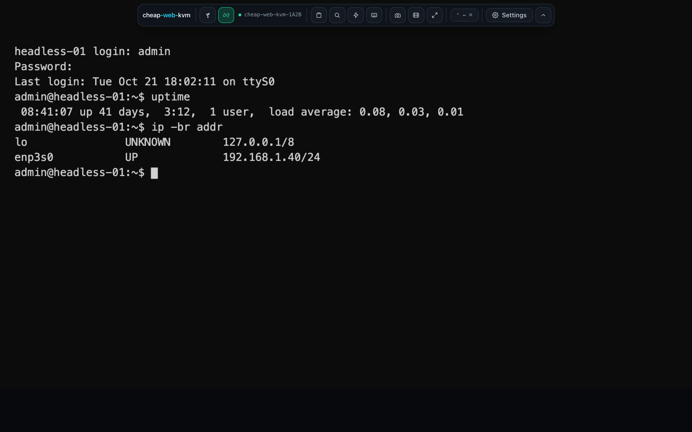
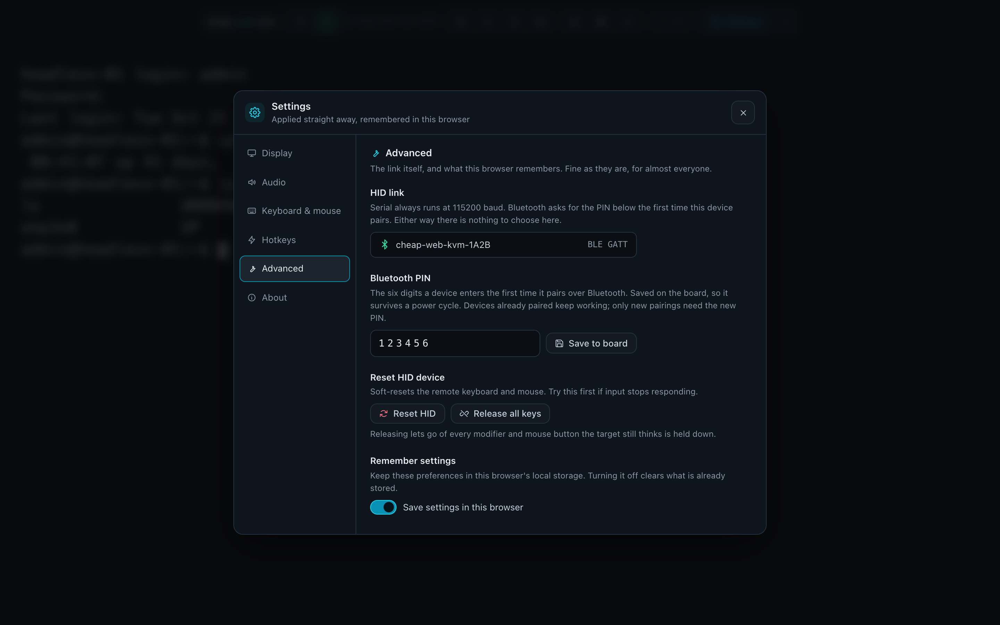
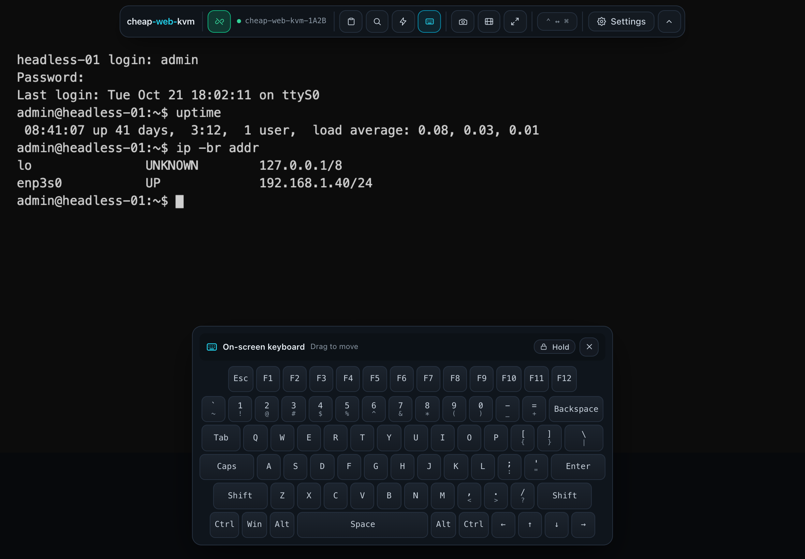

# cheap-web-kvm

A USB KVM made from an ESP32-S3 dev board and an HDMI capture stick. Control a
headless machine's keyboard, mouse and video from a browser on a laptop or iPad.
No drivers or software to install.



_Screenshots use a simulated target display._

Based on [tobychui/DezKVM-Go](https://github.com/tobychui/DezKVM-Go). The web UI
(paste box, on-screen keyboard, hotkeys and macros, screen recorder, OCR copy
box, stacked keys, mouse jiggler, settings) is tobychui's work under the GPLv3,
ported to Nuxt and Vue, with Bluetooth and touch input added. See
[NOTICE](NOTICE). For a finished device with a PCB and case for under $20, build
[the original](https://github.com/tobychui/DezKVM-Go).

## How it differs from DezKVM-Go

DezKVM-Go uses an SL2.1A hub, a CH340C USB-serial bridge and a CH9329
serial-to-HID chip. This project replaces the CH340C and CH9329 with one
ESP32-S3. Its firmware speaks the CH9329 serial protocol to the host and
presents a USB HID keyboard and absolute mouse to the target.

Unlike the fixed-function CH9329, an MCU can add features. Bluetooth LE is
implemented but not yet tested on hardware (see [iPad](#ipad)). USB mass
storage, USB Ethernet and Wi-Fi are [stretch goals](#stretch-goals).

Video does not pass through the ESP32. The capture stick is a separate UVC
device plugged into the host.

## Hardware

| Item | Part | Notes |
|---|---|---|
| MCU board | ESP32-S3-DevKitC-1-N8R8 | 8 MB flash. Clone boards are fine. |
| Capture | MS2130 HDMI to USB dongle | 1080p60, cleaner UVC descriptors than the MS2109. The MS2109 also works. |
| Cables | 2× USB-C, 1× HDMI | |

```
  laptop ──USB-C──> [UART port: CP2102N/CH340] ─UART0─┐
                                                      ├── ESP32-S3
  target <──USB-C── [USB port: native OTG, GPIO19/20] ┘

  target ──HDMI──> MS2130 ──USB-A──> laptop     (separate, no firmware involved)

  iPad ···Bluetooth LE··· ESP32-S3              (instead of the UART cable)
```

### Before first power-up

* Port order varies. Official Espressif boards have the UART bridge on the left
  and native USB on the right. Many clones swap them. On a blank board, only the
  bridge port shows up as a serial device.
* Leave the OTG solder jumper open. On clones that have it, closing it shorts
  the diode in the native port's VBUS line that keeps the target's and host's
  5 V apart. Same for the IN-OUT jumper on the 5 V pin.
* Host and target share ground through the board. Consider isolation if the
  target is on rack power.
* Check the module with `esptool.py flash_id`. Boards are often mislabelled
  N8R8, N16R8 or N8R2.

## Firmware

Requires [ESP-IDF 5.3 or newer](https://docs.espressif.com/projects/esp-idf/en/stable/esp32s3/get-started/)
for the `esp_driver_uart` component. Tested with 5.4.

```bash
cd firmware && idf.py set-target esp32s3 && idf.py build
idf.py -p /dev/tty.usbserial-XXXX flash
```

Flash over the UART port. esptool uses the ROM bootloader on UART0, so this
works whatever the app does with the pins.

`sdkconfig.defaults` only applies to a new config. If you built before Bluetooth
was added, delete `firmware/sdkconfig` and rebuild.

### Bluetooth PIN

Bluetooth only accepts input from a paired device. Pairing needs a six-digit
PIN, `123456` by default.

* Change it in the web UI under Settings → Advanced → Bluetooth PIN, over serial
  or Bluetooth.
* The PIN and pairings are stored in NVS. They survive power cycles and
  reflashing but not `idf.py erase-flash`. After an erase, remove the board
  from the host's Bluetooth settings and pair again.
* Devices already paired keep working. New pairings need the new PIN.
* The board logs a warning at boot while the PIN is `123456`.
* `idf.py menuconfig` → cheap-web-kvm sets the default PIN or turns Bluetooth
  off. A PIN saved from the UI overrides the default.
* Anyone in radio range who knows the PIN can pair and send keystrokes.

From the command line:

```bash
python3 tools/ch9329_test.py -p /dev/tty.usbserial-XXXX --set-passkey 654321
```



### Console

The log console is on UART1: GPIO17 (TX), GPIO18 (RX). Read it with a separate
USB-serial adapter, or set `CONFIG_ESP_CONSOLE_NONE` to turn it off. UART0
carries the host protocol, and native USB cannot run a console alongside HID
because USB-OTG and USB Serial/JTAG share GPIO19/20.

## Web UI

Nuxt 4, Vue 3, TypeScript and Tailwind CSS, statically generated. Web Serial and
Web Bluetooth need a secure context, so serve it over HTTPS or from `localhost`.
Desktop Chrome and Edge have both, so a laptop can also use Bluetooth instead of
the UART cable. On Linux, Web Bluetooth is behind a browser flag.

* Hosted: <https://thebentern.github.io/cheap-web-kvm/>, deployed by
  [GitHub Actions](.github/workflows/deploy-pages.yml) on pushes to `main` that
  change `web/` or `docs/PROTOCOL.md`.
  Docs are at [`/docs`](https://thebentern.github.io/cheap-web-kvm/docs).
* Offline: `cd src && ./sync_www.sh && ./start.sh`, then open
  `https://localhost:8443/` in a Chromium browser. Needs Node.js and Go
  1.24 or newer. The Go server serves `src/www/` and creates a self-signed
  certificate on first run.

```bash
cd web
npm install
npm run dev        # http://localhost:3000
npm run test       # protocol and touch gesture tests
npm run generate   # static build into web/.output/public
```

### iPad

iPads have no Web Serial, so the keyboard and mouse use Bluetooth.

1. Use a USB-C iPad on iPadOS 17 or later, which exposes USB cameras to
   `getUserMedia`. Connect the capture stick with a USB-C to USB-A adapter.
   Lightning iPads do not support external cameras.
2. Install [Bluefy](https://apps.apple.com/app/id1492822055) or another browser
   that adds Web Bluetooth. Safari and Chrome on iPad do not have it.
3. Open the hosted UI in that browser, press the Bluetooth button in the
   toolbar, pick `cheap-web-kvm-XXXX` and enter the PIN (`123456` by default).



A trackpad or mouse works as usual. Relative mouse mode is under Settings →
Keyboard & mouse. Touch gestures:

| Gesture | Absolute mouse mode (default) | Relative mouse mode |
|---|---|---|
| Tap | Click where you tapped | Quick tap: click where the pointer is |
| One-finger drag | Drag with the left button held | Move the pointer, like a trackpad |
| Two-finger drag | Scroll under your fingers | Scroll |
| Two-finger tap | Right-click where you tapped | Right-click where the pointer is |

* Apple Pencil acts as a mouse in absolute mode (contact presses the left
  button, hover moves the pointer where supported) and as a finger in relative
  mode.
* A touch that starts in the black bars around the picture is ignored.
* A touch does not press a button until it is a tap or a drag, so the first
  finger of a two-finger scroll or a pinch does not click.
* Over Bluetooth, queued pointer moves and scroll ticks are merged
  ([PROTOCOL.md §5](docs/PROTOCOL.md#5-timing)). The pointer updates less often
  than over a cable. Clicks and keystrokes are never merged.

### Offline use

Everything is vendored except OCR training data for languages other than
English. Tesseract, its worker, the WASM core and the English data are in
`web/public/vendor/tesseract`. The other 19 languages download when picked and
are listed under "Downloaded on first use".

### Layout

| Path | What |
|---|---|
| `web/app/utils/ch9329.ts` | Wire protocol. Pure functions, no browser APIs. |
| `web/app/utils/touchGestures.ts` | Touch gesture recognizer. Pure, no DOM. |
| `web/app/composables/` | Serial and Bluetooth transports, HID state, capture, settings, panels. |
| `web/app/components/` | One component per panel. |
| `web/app/pages/` | `index.vue` is the KVM, `docs/` is the documentation. |
| `web/test/` | Protocol golden-frame tests and gesture tests. |

`npm run test` checks `ch9329.ts` against the same golden frames as
`tools/ch9329_test.py`, which were verified against the firmware on hardware.
CI does not deploy if they fail. Do not edit the golden frames to make a test
pass.

## Testing

No hardware needed:

```bash
# USB descriptors in the built ELF: boot keyboard on interface 0,
# absolute axes with a 4095 logical maximum. Run after idf.py build, in the
# ESP-IDF environment (it uses xtensa-esp32s3-elf-nm and objdump).
python3 tools/verify_descriptors.py

# Frame builder against the golden frames.
python3 tools/ch9329_test.py --selftest
```

With the board on the UART port, no browser:

```bash
python3 tools/ch9329_test.py -p /dev/tty.usbserial-XXXX --info
python3 tools/ch9329_test.py -p /dev/tty.usbserial-XXXX --type "hello world"
python3 tools/ch9329_test.py -p /dev/tty.usbserial-XXXX --mouse
python3 tools/ch9329_test.py -p /dev/tty.usbserial-XXXX --soak 2000
python3 tools/ch9329_test.py -p /dev/tty.usbserial-XXXX --passkey
```

## Status

| | Milestone | State |
|---|---|---|
| M1 | Boot keyboard and absolute mouse enumerate on the target | Descriptors verified in the binary and TinyUSB starts on hardware. Enumeration on a target not yet confirmed. |
| M2 | CH9329 frames on UART0 drive HID reports | Verified on hardware. All four commands ACK; 1000/1000 reports in a soak with no timeouts or errors. |
| M3 | Web UI drives the target end to end | Implemented, not yet confirmed. |
| M4 | Reconnect, power-cycle survival, sustained typing | Sustained typing verified (soak above). Power-cycle survival not yet confirmed. |
| M5 | Bluetooth LE transport and iPad support | Bluetooth PIN read and change over UART verified on hardware. The UI's Bluetooth queue tested against a simulated device. Bluetooth pairing, the iPad and touch input not yet confirmed. |

Tested on an ESP32-S3-DevKitC-1-N8R8 (rev v0.2, 8 MB flash, 8 MB PSRAM) with
nothing on the native port, so `--info` reports `USB enumerated: no`.

### Stretch goals

* USB MSC virtual media: expose an SD card or flash partition as mass storage to
  boot an ISO on the target. Not possible with a CH9329. Watch UEFI behaviour
  when adding a third USB interface.
* Wi-Fi transport: SoftAP, a LittleFS-hosted UI and WebSocket, for targets out of
  cable reach. Web Serial stays the default.
* USB Ethernet (RNDIS/ECM) to the target.

### Not planned

* Video capture in firmware. The ESP32-S3 cannot do it.
* A custom PCB. The point is a dev board and a stock capture stick.
* Reimplementing [DezKVM](https://github.com/tobychui/DezKVM), a separate IP-KVM
  project with a different design.

## Documentation

* [docs/PROTOCOL.md](docs/PROTOCOL.md): the wire protocol as the web UI sends
  it, including the Bluetooth transport. Read it before changing the parser.
* [NOTICE](NOTICE): attribution and the changes made to upstream.

## License

GPLv3, matching upstream. See [LICENSE](LICENSE).

Upstream's hardware files (`PCB/`, `3D Models/`) are CC BY-NC-ND
(non-commercial, no derivatives) and are not included. Get them from
[upstream](https://github.com/tobychui/DezKVM-Go) under those terms.
