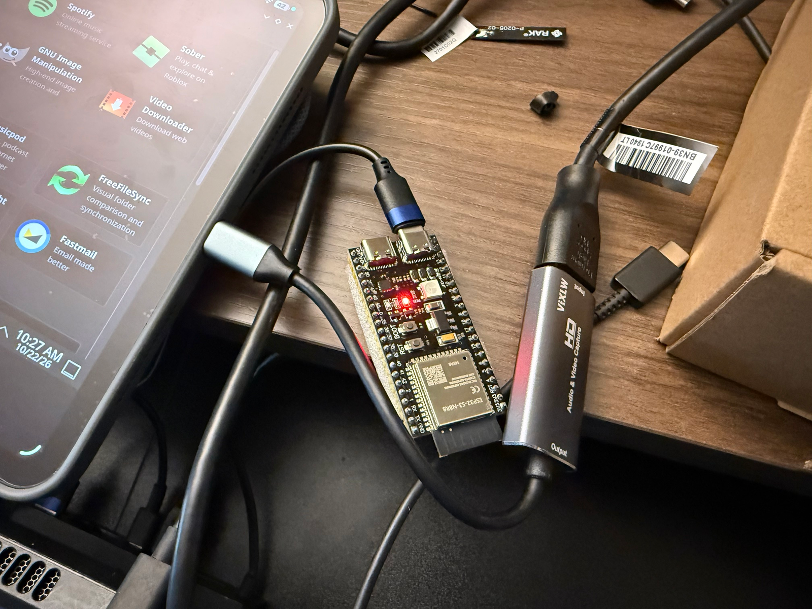
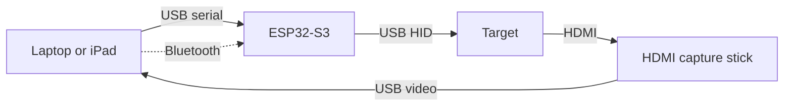

<h1>
  <picture>
    <source media="(prefers-color-scheme: dark)" srcset="web/public/brand/logo-dark.svg">
    
  </picture>
</h1>

A USB KVM made from an ESP32-S3 dev board and an HDMI capture stick. Control a
headless machine's keyboard, mouse and video from a browser on a laptop or iPad.
No drivers or software to install.


_Screenshots use a simulated target display and Bluetooth KVM connection._

Based on [tobychui/DezKVM-Go](https://github.com/tobychui/DezKVM-Go). The web UI
(paste box, on-screen keyboard, hotkeys and macros, screen recorder, OCR copy
box, stacked keys, mouse jiggler, settings) is tobychui's work under the GPLv3,
ported to Nuxt and Vue, with Bluetooth and touch input added. See
[NOTICE](NOTICE). For a finished device with a PCB and case for under $20, build
[the original](https://github.com/tobychui/DezKVM-Go).

## How it differs from DezKVM-Go

DezKVM-Go uses an SL2.1A hub, a CH340C USB-serial bridge and a CH9329
serial-to-HID chip. This project replaces the CH340C and CH9329 with one
ESP32-S3. Its firmware speaks the CH9329 serial protocol to the host and
presents a USB HID keyboard and absolute mouse to the target.

Unlike the fixed-function CH9329, an MCU can add features. Bluetooth LE is
implemented but not yet tested on hardware (see [iPad](#ipad)). Experimental USB mass storage, FAT32 file sharing, Wi-Fi media transport and
firmware-controlled boot-key repetition are now available; see
[Virtual media](docs/VIRTUAL_MEDIA.md). Wyse boot and board performance still
need hardware validation. USB Ethernet remains a stretch goal.

Video does not pass through the ESP32. The capture stick is a separate UVC
device plugged into the host.

## Virtual media (experimental)

Stream an `.img`, directly imported `.img.xz`, or USB-bootable hybrid ISO from
the browser, or create an actual FAT32 thumb drive for ordinary file sharing. The source stays unchanged;
optional target writes commit to a persistent browser overlay before they are
acknowledged. Safely eject before client edits, retrieving target-created files,
or exporting the updated image. F12 repetition runs in firmware across target
reboots, with configurable timing and cancellation.

Virtual media connects over the USB programming cable at **921600 baud by
default**, or over Wi-Fi from the board's own HTTPS console. For Wi-Fi, configure
Hotspot or Client in **Settings → Wi-Fi** through USB/Bluetooth first;
[network settings](docs/WIFI.md) persist on the board. Open its HTTP IP for
certificate setup, verify the public authority against its USB/Bluetooth
fingerprint, manually trust it once per client, then open its HTTPS IP and pair
using the saved media access token. The Go helper remains optional. Fresh
installations start Wi-Fi off. Serial/Bluetooth HID remains available. Older
firmware configured at 115200 needs that matching browser setting.
Follow the [setup and persistence guide](docs/VIRTUAL_MEDIA.md) and
[hardware acceptance procedure](docs/validation/virtual-media.md) for measured
transport results and outstanding Wyse boot validation. The published mPWRD-OS
UEFI raw image was inspected for its x86_64 fallback loader, not booted on hardware.

## Hardware

| Item | Part | Notes |
|---|---|---|
| MCU board | ESP32-S3-DevKitC-1-N8R8 | 8 MB flash; on-board HTTPS needs working PSRAM. Match the RAM profile to the actual module. |
| Capture | MS2130 HDMI to USB dongle | 1080p60, cleaner UVC descriptors than the MS2109. The MS2109 also works. |
| Cables | 2× USB-C, 1× HDMI | |





Solid lines are cables, the dotted line is Bluetooth. The target sees the ESP32-S3
as a USB keyboard and mouse (USB HID). An iPad uses Bluetooth; a laptop can use
either link. Both can be connected at once, but each sends the full key and
button state, so type from one at a time.

### Before first power-up

* Port order varies. Official Espressif boards have the UART bridge on the left
  and native USB on the right. Many clones swap them. On a blank board, only the
  bridge port shows up as a serial device.
* Leave the OTG solder jumper open. On clones that have it, closing it shorts
  the diode in the native port's VBUS line that keeps the target's and host's
  5 V apart. Same for the IN-OUT jumper on the 5 V pin.
* Host and target share ground through the board. Consider isolation if the
  target is on rack power.
* Check the module with `esptool.py flash_id`. Boards are often mislabelled
  N8R8, N16R8 or N8R2.

## Firmware

### Install from the browser

Use desktop Chrome or Edge and open the [hosted installer](https://thebentern.github.io/cheap-web-kvm/flash).
You can also select **Install firmware** from the console toolbar or its
**Tools** menu. Web Serial requires HTTPS or `localhost`.

1. Connect the ESP32-S3 board's **USB-UART bridge port** to the laptop. Close
   any active KVM serial connection or serial monitor using that port.
2. In the installer, connect to the board's UART serial port and install the
   bundled firmware. The build is for the **ESP32-S3-DevKitC-1-N8R8 with 8 MB
   flash**. The native USB port is for the target keyboard and mouse.
3. Keep the cable connected until the installer finishes. Reset the board if
   it does not restart automatically, then return to the console.

If automatic bootloader entry fails, hold **BOOT**, tap **RESET/EN**, then
release **BOOT** and retry. This uses the ESP32's ROM bootloader and works even
when the installed application is not responding.

The installer writes three separate binaries: bootloader, partition table and
application. The current factory app area ends at `0x400000` on the 8 MB board;
NVS at `0x9000..0xf000` and PHY data at `0xf000..0x10000` remain in place. It
preserves the Bluetooth PIN/bonds, Wi-Fi settings and per-device HTTPS identity
without erasing the whole chip. The hosted site bundles firmware from
the same Git commit as the web app. Its default LED pin is GPIO48; see
[RGB status LED](#rgb-status-led) for GPIO38 boards and custom builds.

The published build uses **Octal PSRAM** for the advertised N8R8 module. Some
similarly labelled boards contain R2 hardware with **2 MB Quad PSRAM** instead.
For those, use a locally built Quad profile below; RAM wiring mode is not selected
automatically at runtime. A board that boots without detected RAM can still offer
USB/Bluetooth control and HTTP setup, but may not have enough memory to start
HTTPS alongside Wi-Fi and Bluetooth.

### Build and flash locally

Requires [ESP-IDF 5.3 or newer](https://docs.espressif.com/projects/esp-idf/en/stable/esp32s3/get-started/)
for the `esp_driver_uart` component. Tested with 5.4.

Build the root-based static UI before the firmware; CMake packs its core assets
into flash and fails if the generated site is missing or uses the Pages base URL.
The optional OCR resources and browser-flash binaries are not embedded.

```bash
cd web
npm ci
NUXT_APP_BASE_URL=/ npm run generate
cd ../firmware
idf.py set-target esp32s3
idf.py build
idf.py -p /dev/tty.usbserial-XXXX flash
```

Flash over the UART port. esptool uses the ROM bootloader on UART0, so this
works whatever the app does with the pins.

`sdkconfig.defaults` only applies to a new config. When migrating an old build,
regenerate `firmware/sdkconfig` from the current defaults so it uses the custom
partition table and HTTPS options; retain any custom configuration separately.
Changing the app/partition images leaves NVS intact.

#### Match the PSRAM mode

On-board HTTPS requires functioning PSRAM for TLS while Wi-Fi and Bluetooth are
active. `sdkconfig.defaults` enables Octal RAM for N8R8, lets larger general/mbedTLS
allocations use PSRAM, and ignores missing RAM so basic bring-up does not panic.
That fallback does not guarantee enough internal memory for HTTPS.

For an R2 module, first retain your old configuration separately and start with
no existing `firmware/sdkconfig`. After generating the root-based UI, build with
this checked-in overlay from `firmware/`:

```bash
idf.py -D "SDKCONFIG_DEFAULTS=sdkconfig.defaults;sdkconfig.quad-psram" build
```

For a custom configuration, use **Component config → ESP PSRAM → SPI RAM config
→ Mode (QUAD/OCT) of SPI RAM chip in use** in `idf.py menuconfig`. Choose Quad for
R2 or Octal for R8 and verify successful RAM initialization in the boot log. The
build must match the actual chip; enabling PSRAM does not automatically distinguish
Quad from Octal wiring. Existing `sdkconfig` values take precedence over defaults.

To include a local build in the web installer, run this from the repository
root after `idf.py build`, before starting or generating the web app:

```bash
python3 tools/package_firmware.py
```

This validates `firmware/build/flasher_args.json` and the partition layout,
then creates `web/public/firmware/manifest.json` and the three binaries with
sizes and SHA-256 checksums. Generated firmware files are ignored by Git.

### RGB status LED

The onboard NeoPixel uses the **Quiet status** scheme. It stays dim during
normal use, with brief brighter pulses for input.

| State | Color | Pattern |
|---|---|---|
| Starting | White | One 700 ms fade. |
| Waiting for the USB target | Amber | Slow 3-second breath. |
| Target has enumerated the keyboard and mouse | Green | Dim, steady. |
| Bluetooth pairing | Blue | Two 120 ms pulses, 400 ms apart, every 2.4 seconds. |
| Keyboard or mouse input sent to USB | Green | One 80 ms brightness lift. Continuous input is coalesced. |
| Input dropped | Red | One 180 ms flash, then return to the current status. |

Pairing takes precedence over the target status; a dropped-input warning
briefly overrides both. After pairing ends, the light returns to the USB target
status. Green activity means the USB stack accepted an input report for
transmission; it cannot confirm the target processed it. The LED does not
indicate HDMI/video health or whether a browser has opened the serial port.

Open **Status LED legend** in the console toolbar or its **Tools** menu for the same
reference, including when disconnected.

`idf.py menuconfig` → **cheap-web-kvm** lets you disable the LED, select its
GPIO, and adjust its brightness cap. The default cap is 10%, with steady green
at half that level. The default GPIO is **48**, used by the original DevKitC-1
and many clones. Official **v1.1 boards use GPIO38**; check your board revision
and select the appropriate pin ([Espressif board guide](https://docs.espressif.com/projects/esp-dev-kits/en/latest/esp32s3/esp32-s3-devkitc-1/user_guide_v1.1.html)).
Boards without an addressable LED can disable it. An LED initialization failure
is logged and leaves keyboard, mouse, and Bluetooth operation available.

### Bluetooth PIN

Bluetooth only accepts input from a paired device. Pairing needs a six-digit
PIN, `123456` by default.

* Change it in the web UI under Settings → Advanced → Bluetooth PIN, over serial
  or Bluetooth.
* The PIN and pairings are stored in NVS. They survive power cycles and
  reflashing but not `idf.py erase-flash`. After an erase, remove the board
  from the host's Bluetooth settings and pair again.
* Devices already paired keep working. New pairings need the new PIN.
* The board logs a warning at boot while the PIN is `123456`.
* `idf.py menuconfig` → cheap-web-kvm sets the default PIN or turns Bluetooth
  off. A PIN saved from the UI overrides the default.
* Anyone in radio range who knows the PIN can pair and send keystrokes.

From the command line:

```bash
python3 tools/ch9329_test.py -p /dev/tty.usbserial-XXXX --set-passkey 654321
```


### Console

The log console is on UART1: GPIO17 (TX), GPIO18 (RX). Read it with a separate
USB-serial adapter, or set `CONFIG_ESP_CONSOLE_NONE` to turn it off. UART0
carries the host protocol, and native USB cannot run a console alongside HID
because USB-OTG and USB Serial/JTAG share GPIO19/20.

## Web UI

Nuxt 4, Vue 3, TypeScript and Tailwind CSS, statically generated. Web Serial and
Web Bluetooth need a secure context, so serve it over HTTPS or from `localhost`.
Desktop Chrome and Edge have both, so a laptop can also use Bluetooth instead of
the UART cable. On Linux, Web Bluetooth is behind a browser flag.

* On the board: configure Wi-Fi through USB/Bluetooth, open `http://BOARD_IP/`
  for certificate setup, verify the certificate fingerprint independently and
  manually install trust once per client, then open `https://BOARD_IP/`. Pair
  **Virtual media → Wi-Fi** with the media access token from Settings → Wi-Fi →
  Advanced. The board serves the console and authenticated media directly; no
  helper is required. [Full setup](docs/WIFI.md#open-the-board-hosted-console).
* Hosted: <https://thebentern.github.io/cheap-web-kvm/>, deployed by
  [GitHub Actions](.github/workflows/deploy-pages.yml) on pushes to `main` that
  change the web app, firmware, firmware packaging tools or protocol docs.
  The workflow builds and publishes matching web and firmware artifacts together.
  Docs are at [`/docs`](https://thebentern.github.io/cheap-web-kvm/docs).
* Full local app/optional helper: `cd src && ./sync_www.sh && ./start.sh`, then open
  `https://localhost:8443/` in a Chromium browser. Needs Node.js and Go
  1.24 or newer. The Go server serves `src/www/` and creates a self-signed
  certificate on first run. Install a certificate trusted by your browser before
  using secure browser APIs; another LAN client also needs a certificate covering
  this computer's LAN IP or hostname.

The on-board build omits the oversized OCR engine/language resources and disables
its OCR control with a link to the full app. Its firmware-install action opens
the hosted installer. Disk images and overlays stay in the browser's storage,
which is separate for each origin; localhost files do not automatically appear
at the board's HTTPS address. The board's per-device authority survives DHCP
changes and normal renewal of its 800-day server certificate; client trust does
not need reinstalling after that renewal. Client-mode network time and an initial
firmware-build timestamp support issuing current certificates. A long-isolated
board with an expired certificate and stale clock needs a usable time source or
fresh firmware; offline operation does not extend certificate validity. An NVS
erase requires verifying and trusting the replacement authority.

```bash
cd web
npm install
npm run dev        # http://localhost:3000
npm run test       # protocol and touch gesture tests
npm run generate   # static build into web/.output/public
```

### iPad

iPads have no Web Serial. After initial network and certificate setup, the
board-hosted HTTPS console can carry keyboard/mouse and media over Wi-Fi.
Bluetooth remains an alternative using a compatible browser:

1. Use a USB-C iPad on iPadOS 17 or later, which exposes USB cameras to
   `getUserMedia`. Connect the capture stick with a USB-C to USB-A adapter.
   Lightning iPads do not support external cameras.
2. Install [Bluefy](https://apps.apple.com/app/id1492822055) or another browser
   that adds Web Bluetooth. Safari and Chrome on iPad do not have it.
3. Open the hosted UI in that browser, press the Bluetooth button in the
   toolbar, pick `cheap-web-kvm-XXXX` and enter the PIN (`123456` by default).


A trackpad or mouse works as usual. Relative mouse mode is under Settings →
Keyboard & mouse. Touch gestures:

| Gesture | Absolute mouse mode (default) | Relative mouse mode |
|---|---|---|
| Tap | Click where you tapped | Quick tap: click where the pointer is |
| One-finger drag | Drag with the left button held | Move the pointer, like a trackpad |
| Two-finger drag | Scroll under your fingers | Scroll |
| Two-finger tap | Right-click where you tapped | Right-click where the pointer is |

* Apple Pencil acts as a mouse in absolute mode (contact presses the left
  button, hover moves the pointer where supported) and as a finger in relative
  mode.
* A touch that starts in the black bars around the picture is ignored.
* A touch does not press a button until it is a tap or a drag, so the first
  finger of a two-finger scroll or a pinch does not click.
* Over Bluetooth, queued pointer moves and scroll ticks are merged
  ([PROTOCOL.md §5](docs/PROTOCOL.md#5-timing)). The pointer updates less often
  than over a cable. Clicks and keystrokes are never merged.

If the video drops, the page reconnects on its own and Settings → Display →
Capture events shows why. Common causes on an iPad:

* The screen locked. The page keeps the screen on once you have tapped it, but
  Low Power Mode cuts auto-lock to 30 seconds.
* A call, Siri or an alarm interrupted audio, which also pauses the camera. If
  this keeps happening, turn off audio in Settings → Audio.
* Split View, Slide Over, Stage Manager, or another app using the camera.

If it does not come back, tap Restart video.

### Offline use

The full hosted/local app vendors everything except OCR training data for
languages other than English. The flash-sized on-board build excludes OCR;
its core console, device settings and virtual media are available offline once
Wi-Fi and certificate trust are configured. In the full app, Tesseract, its worker,
the WASM core and the English data are in `web/public/vendor/tesseract`. The other 19 languages download when picked and
are listed under "Downloaded on first use".

### Layout

| Path | What |
|---|---|
| `web/app/utils/ch9329.ts` | Wire protocol. Pure functions, no browser APIs. |
| `web/app/utils/touchGestures.ts` | Touch gesture recognizer. Pure, no DOM. |
| `web/app/composables/` | Serial and Bluetooth transports, HID state, capture, settings, panels. |
| `web/app/components/` | One component per panel. |
| `web/app/pages/` | `index.vue` is the KVM, `docs/` is the documentation. |
| `web/test/` | Protocol golden-frame tests and gesture tests. |

`npm run test` checks `ch9329.ts` against the same golden frames as
`tools/ch9329_test.py`, which were verified against the firmware on hardware.
CI does not deploy if they fail. Do not edit the golden frames to make a test
pass.

## Testing

No hardware needed:

```bash
# USB descriptors in the built ELF: boot keyboard on interface 0,
# absolute axes with a 4095 logical maximum. Run after idf.py build, in the
# ESP-IDF environment (it uses xtensa-esp32s3-elf-nm and objdump).
python3 tools/verify_descriptors.py

# Frame builder against the golden frames.
python3 tools/ch9329_test.py --selftest

# LED colors, timing, brightness and status priority (needs a host C compiler).
python3 tools/test_led_pattern.py

# Firmware manifest, hashes, layout validation and NVS preservation bounds.
python3 tools/test_package_firmware.py

# Root-based UI assets, compression, routing and flash byte budget.
python3 tools/test_build_device_web.py
```

With the board on the UART port, no browser:

```bash
python3 tools/ch9329_test.py -p /dev/tty.usbserial-XXXX --info
python3 tools/ch9329_test.py -p /dev/tty.usbserial-XXXX --type "hello world"
python3 tools/ch9329_test.py -p /dev/tty.usbserial-XXXX --mouse
python3 tools/ch9329_test.py -p /dev/tty.usbserial-XXXX --soak 2000
python3 tools/ch9329_test.py -p /dev/tty.usbserial-XXXX --passkey
```

## Status

| | Milestone | State |
|---|---|---|
| M1 | Boot keyboard and absolute mouse enumerate on the target | Descriptors verified in the binary and TinyUSB starts on hardware. Enumeration on a target not yet confirmed. |
| M2 | CH9329 frames on UART0 drive HID reports | Verified on hardware. All four commands ACK; 1000/1000 reports in a soak with no timeouts or errors. |
| M3 | Web UI drives the target end to end | Implemented, not yet confirmed. |
| M4 | Reconnect, power-cycle survival, sustained typing | Sustained typing verified (soak above). Power-cycle survival not yet confirmed. |
| M6 | Client-backed USB media, FAT32 sharing and boot repetition | Software checks pass; Wyse boot, physical file transfer and transport measurements outstanding. |
| M5 | Bluetooth LE transport and iPad support | Bluetooth PIN read and change over UART verified on hardware. The UI's Bluetooth queue tested against a simulated device. Bluetooth pairing, the iPad and touch input not yet confirmed. |

The connected test board reports ESP32-S3 rev v0.2, 8 MB flash and **2 MB
AP_3v3 embedded PSRAM**, despite its N8R8 label. It therefore needs the Quad/R2
PSRAM profile for on-board HTTPS. Earlier UART-only tests ran with nothing on the
native port, so those `--info` results reported `USB enumerated: no`.

### Stretch goals

* Hardware qualification for client-backed USB media and FAT32 file sharing;
  see the [validation procedure](docs/validation/virtual-media.md).
* USB Ethernet (RNDIS/ECM) to the target.

### Not planned

* Video capture in firmware. The ESP32-S3 cannot do it.
* A custom PCB. The point is a dev board and a stock capture stick.
* Reimplementing [DezKVM](https://github.com/tobychui/DezKVM), a separate IP-KVM
  project with a different design.

## Documentation

* [docs/PROTOCOL.md](docs/PROTOCOL.md): the wire protocol as the web UI sends
  it, including the Bluetooth transport. Read it before changing the parser.
* [Virtual media](docs/VIRTUAL_MEDIA.md): USB/Wi-Fi connection, FAT32 files, persistent
  overlays, exports, boot repetition and outstanding hardware validation.
* [NOTICE](NOTICE): attribution and the changes made to upstream.

## License

GPLv3, matching upstream. See [LICENSE](LICENSE).

Upstream's hardware files (`PCB/`, `3D Models/`) are CC BY-NC-ND
(non-commercial, no derivatives) and are not included. Get them from
[upstream](https://github.com/tobychui/DezKVM-Go) under those terms.
