<h1>
  <picture>
    <source media="(prefers-color-scheme: dark)" srcset="web/public/brand/logo-dark.svg">
    
  </picture>
</h1>

## $12 HDMI capture dongle + $8 ESP32-S3 dev board = $KVM

Control a headless machine's keyboard, mouse and video from a browser on a
laptop or iPad. No target-side drivers or software to install.

_Prices are approximate (USD); USB and HDMI cables are extra._

[Open the console](https://thebentern.github.io/cheap-web-kvm/) ·
[Install firmware](https://thebentern.github.io/cheap-web-kvm/flash)

## Hardware

| Item | Part | Notes |
|---|---|---|
| Board | ESP32-S3-DevKitC-1-N8R8 | Published firmware targets 8 MB flash and Octal PSRAM. |
| Capture | MS2130 HDMI-to-USB dongle | 1080p60. MS2109 also works. |
| Cables | 2× USB-C, 1× HDMI | Add a USB-A adapter if the client needs one. |

### Before first power-up

* Identify the **UART bridge** and **native USB** ports; their positions vary
  between boards. On a blank board, only the bridge appears as a serial device.
* Leave the **OTG** and **5 V IN-OUT** solder jumpers open so the host and target
  power supplies stay separated by the board's VBUS protection diode.
* Host and target share ground. Consider isolation for a target on rack power.
* Check the actual flash and PSRAM: N8R8-labelled boards can contain R2 hardware.

### Match the PSRAM mode

The published build uses **Octal PSRAM (R8)**. Boards with **Quad PSRAM (R2)**
need a [custom firmware build](docs/DEVELOPMENT.md#match-the-psram-mode).
The mode is not detected automatically. USB/Bluetooth may work without PSRAM,
but the board's HTTPS console requires working PSRAM.

## Quick start

Use desktop Chrome or Edge for initial installation and USB setup.

1. Connect the board's **UART bridge port** to the laptop. Close other apps
   using that serial port, then open the [firmware installer](https://thebentern.github.io/cheap-web-kvm/flash)
   and install the firmware for your board. If bootloader entry fails, hold
   **BOOT**, tap **RESET/EN**, release **BOOT**, and retry.
2. Connect the board's **native USB port** to the target. Connect the target's
   HDMI output to the capture dongle, and plug the dongle into the laptop.
3. Open the [console](https://thebentern.github.io/cheap-web-kvm/), choose the
   capture device and connect using **USB**. The default baud rate is **921600**;
   older or custom firmware needs its matching browser setting.
4. Click the video to control the target. For BIOS/UEFI, select **relative mouse
   mode** under **Settings → Keyboard & mouse**. Press **Esc** to release capture.

Normal firmware updates preserve Bluetooth pairings, Wi-Fi settings and the
board's HTTPS identity. An NVS erase resets them.

## Connections

| Browser-to-board link | Keyboard/mouse | Virtual media | Setup |
|---|---|---|---|
| USB serial | Yes | Yes (slow) | Desktop Chrome or Edge; HTTPS or `localhost`. |
| Bluetooth LE | Yes | No | Pair with `cheap-web-kvm-XXXX`. Default PIN: `123456`; [change it](docs/USAGE.md#bluetooth-pin). Linux requires a browser flag. |
| Wi-Fi | Yes | Yes | Configure through USB/Bluetooth first, then [trust the board's certificate and pair](docs/WIFI.md#board-hosted-https-console). |

Use one keyboard/mouse control link at a time. Native USB stays connected to
the target; video always comes from the separate capture dongle.

### iPad

USB HDMI capture needs a **USB-C iPad with iPadOS 17+** and a USB-A adapter. iPad has
no Web Serial; use the board's HTTPS console over Wi-Fi, or Bluetooth through
[Bluefy](https://apps.apple.com/app/id1492822055). See the
[iPad guide](docs/USAGE.md#ipad) for pairing, touch gestures and video recovery.

### Virtual media

Boot an `.img`, `.img.xz`, or USB-bootable hybrid ISO, or create a FAT32 drive for
file sharing. Full OS disks need **Allow target to write** and persistent browser
storage. Eject and synchronize before editing or exporting files in the browser.
See the [virtual-media guide](docs/VIRTUAL_MEDIA.md) for setup, writes, exports
and boot-key repetition.

## Development

Build with **ESP-IDF 5.3+** (tested with 5.4). The web app uses Nuxt 4, Vue 3 and
TypeScript. See [Development](docs/DEVELOPMENT.md) for firmware/web builds,
PSRAM configuration, performance profiles and tests. The
[wire protocol](docs/PROTOCOL.md) documents the CH9329-compatible commands.

## Reference

* [Usage](docs/USAGE.md): Bluetooth PIN, status LED, iPad controls and offline use.
* [Wi-Fi](docs/WIFI.md): Hotspot/Client modes, certificate trust and pairing.
* [Virtual media](docs/VIRTUAL_MEDIA.md): Disk formats, persistent writes and recovery.
* [Hardware validation](docs/validation/virtual-media.md): Test coverage and measurements.

## Credits and license

Based on [DezKVM-Go](https://github.com/tobychui/DezKVM-Go) by tobychui. Its web
UI was ported to Nuxt/Vue, with Bluetooth and touch input added. This project
replaces its CH340C/CH9329 serial-to-HID hardware with an ESP32-S3. See
[NOTICE](NOTICE) for attribution and changes.

Software is GPLv3; see [LICENSE](LICENSE). Upstream's PCB and case files are
CC BY-NC-ND and are not included; obtain them from
[upstream](https://github.com/tobychui/DezKVM-Go) under those terms.
